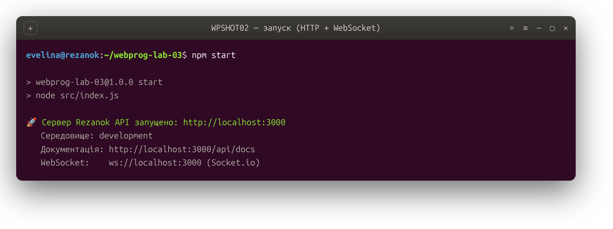
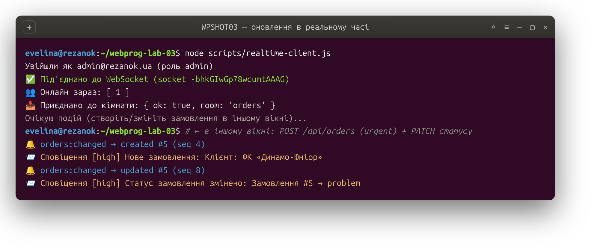
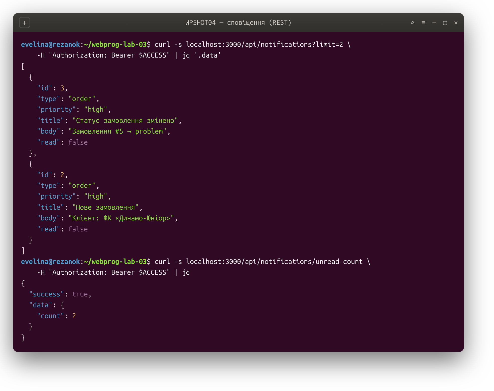
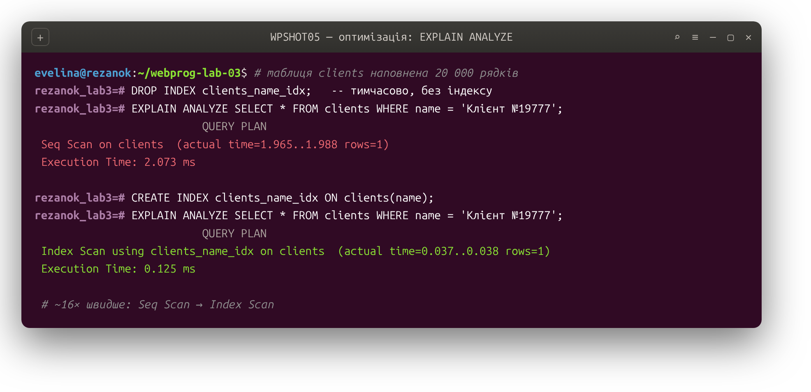
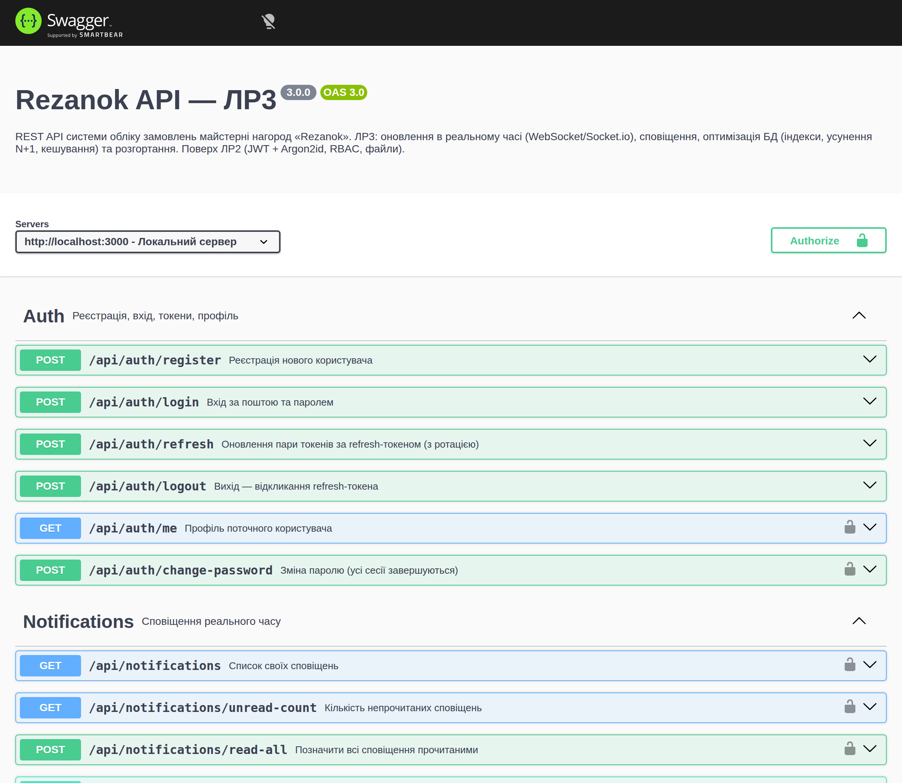

# Rezanok API — WebSocket, оптимізація БД та розгортання

**Лабораторна робота №3 з дисципліни «Вебпрограмування»**
Виконала: Ткачук Евеліна

Продовження серверної частини системи обліку замовлень майстерні нагород **Rezanok** (ЛР1 — REST API, ЛР2 — аутентифікація та авторизація). У цій роботі застосунок стає «живим»: додано обмін даними в реальному часі через **WebSocket (Socket.io)**, систему сповіщень, оптимізацію роботи з базою даних та готовність до розгортання на хостингу. Стек той самий: Node.js + Express + Prisma + PostgreSQL.

---

## 1. Мета та завдання роботи

Метою роботи є набуття практичних навичок упровадження обміну даними в реальному часі з технологією WebSocket, оптимізації роботи з базою даних та розгортання серверного застосунку на хостингу. Якщо попередні роботи давали «запит — відповідь», то ця додає другий, зустрічний напрямок: сервер сам ініціює доставку оновлень клієнтам у момент, коли дані змінюються, без перезавантаження сторінки чи періодичного опитування.

## 2. Що додано порівняно з ЛР2

До захищеного REST API додано рівень реального часу та оптимізації: інтеграцію Socket.io з автентифікацією з'єднань через JWT, систему кімнат для групування клієнтів, оновлення в реальному часі для всіх основних сутностей, персоналізовані сповіщення з типами та пріоритетами (зі зберіганням у БД і доставкою через WebSocket), індикатори онлайн-статусу, відновлення пропущених подій після розриву з'єднання, оптимізацію запитів через індекси, усунення N+1 та кешування, а також конфігурацію й документацію для розгортання на безкоштовному хостингу.

## 3. Технології

До стеку ЛР2 (Express 4, Prisma 5, PostgreSQL 16, Zod, Helmet, JWT, Argon2id, Multer, Swagger) додано:

| Бібліотека | Призначення |
|---|---|
| `socket.io` (v4) | WebSocket-сервер із кімнатами, автоперепідключенням і fallback на long-polling |
| `socket.io-client` (v4) | Клієнт для тестів та демонстраційного скрипта |

Для кешування та відновлення подій використано власні модулі в пам'яті з навмисно простим інтерфейсом, щоб на продакшні їх можна було замінити на Redis (рівень 3) без зміни контролерів.

## 4. Архітектура застосунку

Шарова структура ЛР2 збережена; для реального часу додано каталоги `socket/` та `services/`.

```
webprog-lab-03/
├── prisma/
│   ├── schema.prisma      модель даних + Notification та індекси оптимізації
│   └── migrations/        зокрема realtime-notifications-and-indexes
├── src/
│   ├── socket/
│   │   ├── index.js       initSocket: JWT-автентифікація, кімнати, presence, sync
│   │   ├── presence.js    облік онлайн-статусу (кілька сокетів на користувача)
│   │   ├── eventHistory.js історія подій для відновлення після розриву
│   │   └── broadcast.js   розсилка в кімнату + запис в історію
│   ├── services/
│   │   └── notificationService.js  генерація та доставка сповіщень
│   ├── controllers/       + notificationController; emit-и в order.controller
│   ├── routes/            + notificationRoutes
│   ├── utils/             + cache.js (кеш у пам'яті з інвалідацією)
│   ├── config/            env.js (+ frontendUrl), swagger.js
│   ├── app.js             + /health, Swagger, rate limiting
│   └── index.js           HTTP-сервер + initSocket на одному порту
├── scripts/realtime-client.js  демо-клієнт WebSocket
├── tests/                 auth.test.js + socket.test.js
├── render.yaml            Blueprint для розгортання на Render
└── docker-compose.yml     контейнер PostgreSQL
```

REST і WebSocket обслуговуються **одним HTTP-сервером на одному порту**: у `index.js` сервер створюється явно через `http.createServer(app)`, поверх нього піднімається Socket.io, а екземпляр `io` зберігається в застосунку (`app.set('io', io)`), щоб контролери могли надсилати події через `req.app.get('io')`.

## 5. WebSocket: підключення, автентифікація та кімнати

**Підключення.** Клієнт встановлює з'єднання командою `io(URL, { auth: { token } })`. HTTP-запит з заголовком `Upgrade: websocket` перетворюється на постійний двосторонній канал (статус 101 Switching Protocols), після чого сервер може надсилати дані будь-коли.

**Автентифікація через JWT.** Кожне з'єднання проходить через проміжний обробник `io.use`, який перевіряє access-токен із рукостискання. Без валідного токена з'єднання відхиляється з помилкою `unauthorized` ще до встановлення каналу — це той самий токен, що й для REST, тож безпека єдина для обох протоколів.

**Кімнати.** Після під'єднання користувач автоматично потрапляє у персональну кімнату `user:<id>` (для адресних сповіщень). Додатково клієнт може приєднатися до тематичних кімнат подією `room:join` — наприклад, `orders` (усі, хто стежить за списком замовлень) чи `order:7` (усі, хто відкрив конкретне замовлення). Подія в кімнату доходить лише її учасникам, що й забезпечує логічне групування.

### WebSocket API

| Напрям | Подія | Призначення |
|---|---|---|
| клієнт → сервер | `room:join` (room, ack) | приєднатися до кімнати (з підтвердженням) |
| клієнт → сервер | `room:leave` (room) | вийти з кімнати |
| клієнт → сервер | `sync` ({cursors}, ack) | отримати пропущені події після перепідключення |
| сервер → клієнт | `presence:list` | список онлайн-користувачів (при під'єднанні) |
| сервер → клієнт | `presence:update` | хтось став онлайн/офлайн |
| сервер → клієнт | `orders:changed` | змінився список замовлень (created/updated/deleted) |
| сервер → клієнт | `order:created` / `order:updated` / `order:deleted` | подія конкретного замовлення |
| сервер → клієнт | `<resource>:changed` | зміна будь-якої сутності (clients, payments, …) |
| сервер → клієнт | `notification` | персональне сповіщення |

## 6. Оновлення в реальному часі

Оновлення реалізовано для **всіх основних сутностей**. Типові CRUD-операції через фабрику `crudController` після кожної зміни розсилають подію `<resource>:changed` у кімнату відповідного ресурсу — так клієнти, підписані на `clients`, `employees`, `stock-items`, `payments` тощо, одразу бачать оновлення. Замовлення, як центральна сутність, має багатший набір: при створенні, зміні статусу й видаленні надсилаються події і в загальну кімнату `orders`, і в кімнату конкретного `order:<id>`.

Кожна розіслана подія проходить через єдиний хелпер `broadcast`, який, окрім самої розсилки, записує подію в історію й додає службові поля `_seq` (наскрізний номер) та `_at` (час). Це робить події відстежуваними й уможливлює відновлення після розриву.

## 7. Онлайн-статус і відновлення після розриву

**Онлайн-статус** відстежує модуль `presence`. Оскільки один користувач може мати кілька відкритих вкладок (кілька сокетів), статус рахується за кількістю сокетів: користувач «онлайн», доки відкрито хоча б один. Коли він з'являється або зникає, усім розсилається `presence:update`, а кожен новий сокет одразу отримує повний список онлайн-користувачів.

**Відновлення пропущених подій.** Socket.io сам перепідключається при обриві, але події, що сталися під час відсутності, було б втрачено. Тому кожна подія має наскрізний номер `_seq`, а сервер зберігає історію останніх подій по кожній кімнаті (`eventHistory`). Клієнт запам'ятовує останній отриманий `_seq` по кожній кімнаті й після перепідключення надсилає подію `sync` з цими «курсорами» — сервер повертає всі події, яких клієнт не бачив.

## 8. Система сповіщень

Сповіщення зберігаються в таблиці `notifications` (щоб не губилися між сесіями) і **одночасно** доставляються адресату в реальному часі через його кімнату `user:<id>`. Кожне сповіщення має **тип** (`order`, `payment`, `production`, `system`) та **пріоритет** (`low`, `normal`, `high`) — наприклад, переведення замовлення в проблемний статус створює сповіщення високого пріоритету. Генерацію інкапсульовано в сервісі `notificationService`, який уміє адресувати як одному користувачеві, так і груповою розсилкою всім адміністраторам (batch).

| Метод | Шлях | Дія |
|---|---|---|
| `GET` | `/api/notifications` | Список своїх сповіщень (фільтри `?unread=`, `?type=`) |
| `GET` | `/api/notifications/unread-count` | Кількість непрочитаних (для бейджа) |
| `PATCH` | `/api/notifications/:id/read` | Позначити прочитаним |
| `POST` | `/api/notifications/read-all` | Позначити всі прочитаними |
| `DELETE` | `/api/notifications/:id` | Видалити сповіщення |

## 9. Оптимізація бази даних

**Індексування.** Для колонок, що часто беруть участь у `WHERE` та `ORDER BY`, додано B-tree-індекси через атрибут `@@index` у схемі: за іменем клієнта (пошук), за групою складу, за дедлайном і датою створення замовлення, за датою оплати, а для сповіщень — складений індекс `(userId, readAt)` під головний запит «мої непрочитані». Ефект перевірено на таблиці з 20 000 рядків командою `EXPLAIN ANALYZE`:

```
-- БЕЗ індексу:   Seq Scan on clients    Execution Time: 1.938 ms
-- З  індексом:   Bitmap Index Scan      Execution Time: 0.075 ms
```

Тобто замість послідовного перегляду всієї таблиці (`Seq Scan`) планувальник переходить на пошук за індексом (`Index Scan`), і запит виконується приблизно у **26 разів швидше**. Ціна індексів — трохи повільніший запис та додаткове місце на диску, тому їх додають лише під реальні запити.

**Усунення N+1 та eager loading.** Проблема N+1 виникає, коли для списку записів робиться один запит, а потім ще по одному на кожен пов'язаний запис. У проєкті її усунено наскрізним використанням `include`/`select` у Prisma: наприклад, список замовлень одразу підвантажує клієнта, позиції, їхні стадії з виконавцями, оплати та доставку одним набором запитів, а не окремим запитом на кожне замовлення.

**Кешування.** Для рідко змінюваних списків (працівники, склад) додано кеш у пам'яті з TTL (модуль `cache.js`). При будь-якій зміні відповідної сутності її кеш автоматично скидається (інвалідація в `crudController`), тож клієнт ніколи не бачить застарілих даних. **Пагінація** списків, реалізована ще в ЛР1, діє на всіх ендпоінтах і доповнює оптимізацію, обмежуючи обсяг даних на запит.

## 10. Документація API

Інтерактивна документація Swagger доступна на **`/api/docs`** (і специфікація OpenAPI на `/api/docs.json`). До груп з ЛР2 додано **Notifications**. WebSocket-події задокументовано таблицею в розділі 5 цього звіту, оскільки Swagger/OpenAPI описує лише HTTP.

## 11. Розгортання на хостингу

Застосунок підготовлено до розгортання на **Render** (безкоштовний тариф). У корені є `render.yaml` (Blueprint), який описує вебсервіс Node.js та базу PostgreSQL і повністю автоматизує створення ресурсів.

**Підготовка в коді:** порт читається зі змінної `PORT`, додано легкий ендпоінт перевірки стану `GET /health` (для health-check хостингу), CORS WebSocket налаштовується через `FRONTEND_URL`, секрети беруться зі змінних середовища.

**Кроки розгортання:**

1. Зареєструватися на [render.com](https://render.com) через GitHub.
2. New → **Blueprint** → вказати цей репозиторій. Render прочитає `render.yaml` і створить базу та вебсервіс.
3. Команда збірки застосує міграції: `npm ci && npx prisma generate && npx prisma migrate deploy`, команда запуску — `node src/index.js`.
4. Секрети JWT Render згенерує автоматично (`generateValue: true`), `DATABASE_URL` під'єднається з бази.
5. Після деплою перевірити `GET /health`, документацію `/api/docs` та WebSocket.

**Обмеження безкоштовного тарифу, які враховано:** сервіс «засинає» після 15 хвилин без запитів (перший запит потім триває до хвилини, WebSocket-клієнти перепідключаються — що вже підтримано); файлова система тимчасова, тож завантажені файли зникають після перезапуску; безкоштовна PostgreSQL діє 30 днів. Важливо, що на хостингу застосовують `prisma migrate deploy` (застосовує вже створені міграції без інтерактиву), а не `migrate dev` (створює нові міграції й призначений для розробки).

## 12. Запуск локально

```bash
npm install                 # залежності
docker compose up -d        # PostgreSQL у контейнері
cp .env.example .env        # + згенерувати секрети JWT (див. ЛР2)
npm run prisma:migrate      # застосувати міграції
npm run seed                # демо-дані + користувачі admin/manager
npm start                   # сервер + WebSocket на :3000
npm test                    # тести (REST + WebSocket)
```

Перевірити реальний час: в одному терміналі запустити демо-клієнт `node scripts/realtime-client.js`, а в іншому створити чи змінити замовлення через API — подія та сповіщення з'являться в клієнті миттєво.

## 13. Тестування

Тести на `node:test`. Файл `tests/auth.test.js` (з ЛР2) перевіряє аутентифікацію та захист маршрутів, а новий `tests/socket.test.js` піднімає справжній HTTP+Socket.io сервер і реальним клієнтом перевіряє WebSocket: відхилення підключення без токена, успішне під'єднання з токеном, ізоляцію подій між кімнатами й доставку персональних сповіщень лише адресату, розсилку онлайн-статусу та відновлення пропущених подій через `sync`. Усі тести проходять.

```
# tests 15
# pass 15
# fail 0
```

## 14. Демонстрація роботи

**Запуск сервера.** HTTP-сервер і WebSocket піднімаються на одному порту; доступні документація та Socket.io.



**Оновлення в реальному часі.** Демо-клієнт під'єднується до WebSocket, автентифікується JWT і приєднується до кімнати `orders`. Коли в іншому вікні створюється замовлення через REST, клієнт миттєво отримує подію `orders:changed` та персональне сповіщення — без жодного перезавантаження.



**Сповіщення.** Сповіщення зберігаються в БД і доступні через REST: список, лічильник непрочитаних, позначення прочитаними.



**Оптимізація: `EXPLAIN ANALYZE` до і після індексу.** На таблиці з 20 000 рядків запит без індексу виконує повний послідовний перегляд (`Seq Scan`), а з індексом переходить на пошук за індексом і працює приблизно у 26 разів швидше.



**Інтерактивна документація Swagger UI** за адресою `/api/docs` з новою групою Notifications.



## 15. Висновки

У результаті роботи захищений REST API системи обліку замовлень доповнено рівнем реального часу та оптимізації. Інтегровано Socket.io з автентифікацією з'єднань через JWT, реалізовано кімнати, оновлення в реальному часі для всіх основних сутностей, систему сповіщень із типами, пріоритетами та зберіганням у БД, індикатори онлайн-статусу й відновлення пропущених подій після розриву з'єднання. Проведено оптимізацію бази даних через індексування (з вимірюванням ефекту за `EXPLAIN ANALYZE`), eager loading та кешування з інвалідацією, а застосунок підготовлено до розгортання на безкоштовному хостингу з урахуванням його обмежень. Робота показує, як серверний застосунок із простого «запит — відповідь» виростає до інтерактивної системи, готової обслуговувати багатьох користувачів у реальному часі.
